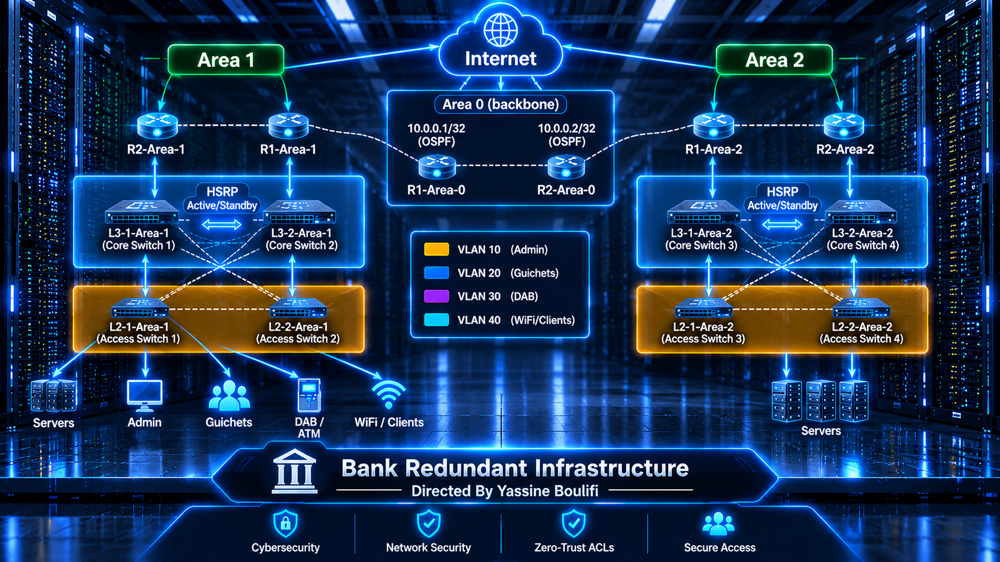

# 🏦 National Bank Secure Enterprise Network

## 📖 Project Overview

This repository contains the complete Cisco Packet Tracer configuration for a highly secure, redundant, and scalable Enterprise Bank Network. The goal of this project was to design an architecture that ensures maximum uptime for critical banking operations while enforcing strict Zero-Trust security policies.

## 🏗️ Network Architecture

* **Core Layer (Area 0):** Dual Cisco Routers (`R1AREA0`, `R2AREA0`) handling OSPF routing, NAT/PAT, and internet edge connectivity.
* **Distribution Layer:** Dual Layer 3 Switches (`SW-L3-1-A/B`, `SW-L3-2-A/B`) acting as the core for VLANs, DHCP servers, and OSPF Area Border Routers (ABRs). HSRP provides seamless gateway redundancy.
* **Access Layer:** Dual Layer 2 Switches (`SW-L2-1-A/B`, `SW-L2-2-A/B`) providing end-user connectivity with Port Security and LACP EtherChannels for link redundancy.
* **Branches (Area 1 & Area 2):** Dual-redundant routers for each branch, running HSRP and strict Access Control Lists (ACLs).

## 🗺️ IP Addressing & VLAN Schema

| VLAN | Name | Subnet (Branch A) | Subnet (Branch B) | Purpose |
|------|------|-------------------|-------------------|---------|
| 10 | ADMIN | 10.1.10.0/24 | 10.2.10.0/24 | Bank Management / IT Staff |
| 20 | GUICHETS | 10.1.20.0/24 | 10.2.20.0/24 | Teller Windows |
| 30 | DAB | 10.1.30.0/24 | 10.2.30.0/24 | ATMs (Distributeur Automatique de Billets) |
| 40 | WIFI | 10.1.40.0/24 | 10.2.40.0/24 | Guest Wi-Fi (Isolated) |
| 60 | SERVERS | 10.1.60.0/24 | 10.2.60.0/24 | Secure FTP / Web Server |
| 99 | MGMT | 10.1.99.0/24 | 10.2.99.0/24 | Out-of-Band Management |

---

## 🔌 Physical Topology & Cabling

### 📍 Area 1 (Branch A) Connections
*   **Router Interconnect:** R1 (G0/0) `<-->` R2 (G0/0)
*   **Router to L3 Switch:**
    *   R1 (G0/1) `<-->` L3-2 (G1/0/3)
    *   R2 (G0/1) `<-->` L3-1 (G1/0/3)
*   **Core Switch Interconnect (EtherChannel):** L3-1 (G1/0/1-2) `<-->` L3-2 (G1/0/1-2)
*   **Access Switch Interconnect:** L2-1 (Fa0/1-2) `<-->` L2-2 (Fa0/1-2)
*   **L2 to L3 Uplinks (EtherChannels):**
    *   L2-1 (G0/1-2) `<-->` L3-1 (G1/0/4-5)
    *   L2-2 (G0/1-2) `<-->` L3-2 (G1/0/4-5)
    *   L2-1 (Fa0/3) `<-->` L3-2 (G1/0/6)
    *   L2-2 (Fa0/3) `<-->` L3-1 (G1/0/6)

### 📍 Area 2 (Branch B) Connections
*   **Router Interconnect:** R1 (G0/0) `<-->` R2 (G0/0)
*   **Router to L3 Switch:**
    *   R1 (G0/1) `<-->` L3-2 (G1/0/3)
    *   R2 (G0/1) `<-->` L3-1 (G1/0/3)
*   **Core Switch Interconnect (EtherChannel):** L3-1 (G1/0/1-2) `<-->` L3-2 (G1/0/1-2)
*   **Access Switch Interconnect:** L2-1 (Fa0/1-2) `<-->` L2-2 (Fa0/1-2)
*   **L2 to L3 Uplinks (EtherChannels):**
    *   L2-1 (G0/1-2) `<-->` L3-1 (G1/0/4-5)
    *   L2-2 (G0/1-2) `<-->` L3-2 (G1/0/4-5)
    *   L2-1 (Fa0/3) `<-->` L3-2 (G1/0/6)
    *   L2-2 (Fa0/3) `<-->` L3-1 (G1/0/6)

### 📍 Area 0 (Backbone Core Connections)
*   **Branch A to Backbone:** R1 Area 1 (G0/2) `<-->` R1 Area 0 (G0/1)
*   **Branch B to Backbone:** R1 Area 2 (G0/2) `<-->` R2 Area 0 (G0/1)

---

## 🔒 Security Implementations

1. **Zero-Trust ACLs:** Extended ACLs are applied on both Branch Routers and L3 Switches to isolate the Guest Wi-Fi from internal networks, protect the Admin VLAN, and restrict server access to Admin only.
2. **Management Access Control (SSH):** Standard ACLs (`SSH_RESTRICT`) are applied to the VTY lines. Only the Admin and Management VLANs can SSH into the devices, preventing lateral movement from compromised user PCs.
3. **Port Security:** Sticky MAC addresses with a maximum of 1 device per port. Violations trigger `restrict` mode.
4. **Network Hardening:** All unused ports are administratively shut down. Native VLAN is changed to 99 to prevent VLAN hopping attacks.
5. **Device Security:** Console and VTY lines are password-protected with a 5-minute inactivity timeout. Passwords are encrypted, and the MOTD banners enforce legal warnings.

##  How to Deploy

1. Open Cisco Packet Tracer.
2. Drag and drop the required Routers, Layer 3 Switches, Layer 2 Switches, and Servers.
3. Connect the devices according to the topology diagram.
4. Copy and paste the configurations from the `/configs/` folder into the respective CLI.
5. Host the `index.html` file on the internal Server's HTTP service.

*Project by Yassine Boulifi*
